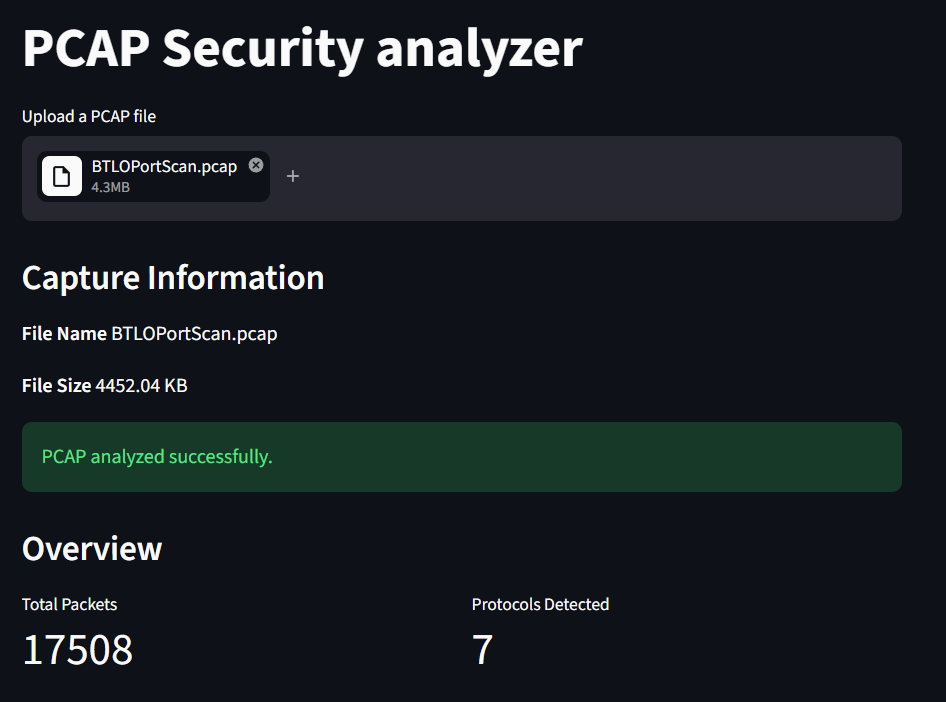
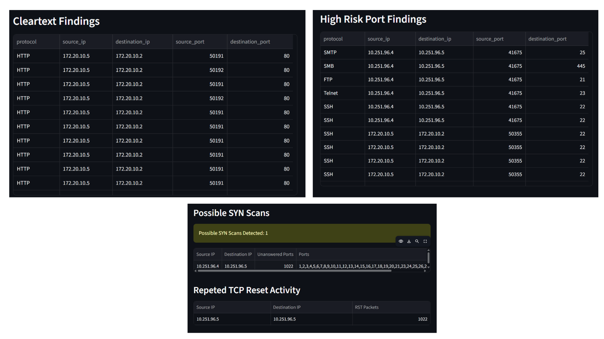

# PCAP Security Analyzer

A Python-based network traffic analysis tool that examines PCAP and PCAPNG files to summarize network activity and identify potential security indicators through an interactive Streamlit dashboard.

## Dashboard Preview

### 1. Dashboard Overview


### 2. Security Findings


### 3. CSV Report Export


## Features

- **Protocol Analysis:** Summarizes packet counts by protocol.
- **IP Analysis:** Identifies top source and destination IP addresses.
- **Port Analysis:** Examines TCP and UDP port activity.
- **DNS Analysis:** Extracts DNS queries and supports domain searching.
- **TCP Flag Analysis:** Visualizes TCP flag activity.
- **Network Conversations:** Reviews communication between network endpoints.
- **Security Detection:** Flags cleartext traffic, high-risk port activity, possible SYN scans, and repeated TCP resets.
- **Severity Labels:** Assigns preliminary rule-based severity levels.
- **CSV Export:** Downloads security findings for further analysis.

## Technology Stack

- Python
- Scapy
- Streamlit
- Pandas

## Getting Started

### 1. Clone the repository

```bash
git clone https://github.com/manthan284/pcap-security-analyzer.git
cd pcap-security-analyzer
```

### 2. Create and activate a virtual environment

```bash
python -m venv .venv
.venv\Scripts\activate
```

### 3. Install dependencies

```bash
pip install -r requirements.txt
```

### 4. Run the application

```bash
streamlit run app.py
```

Open the local URL displayed in the terminal.

## Usage

1. Launch the application.
2. Upload a `.pcap` or `.pcapng` capture file.
3. Explore protocol, IP, port, DNS, TCP flag, and conversation analysis.
4. Review potential security indicators.
5. Download findings as a CSV file.

## Detection Notes

The analyzer uses rule-based heuristics. High-risk port activity, possible SYN scans, and repeated TCP resets are indicators that may warrant investigation; they do not independently prove malicious activity.

## Future Improvements

- AI-assisted analysis of security findings.
- Improved detection accuracy and reduced duplicate findings.
- Expanded IPv6 support and automated testing.
- Enhanced reporting.

## Disclaimer

Use this tool only on network captures you own or are authorized to analyze. PCAP files may contain sensitive information, so handle them carefully.
